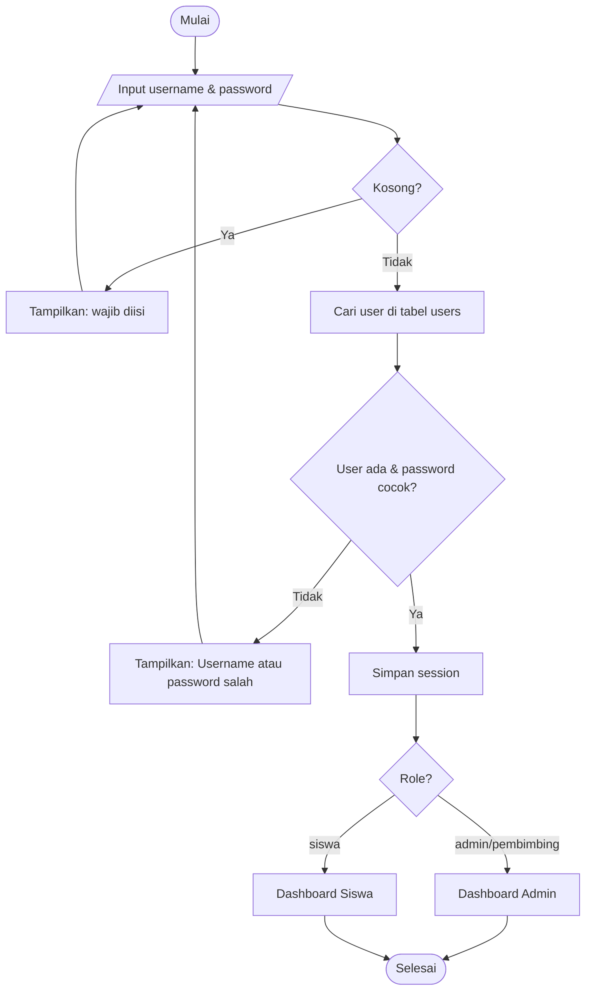
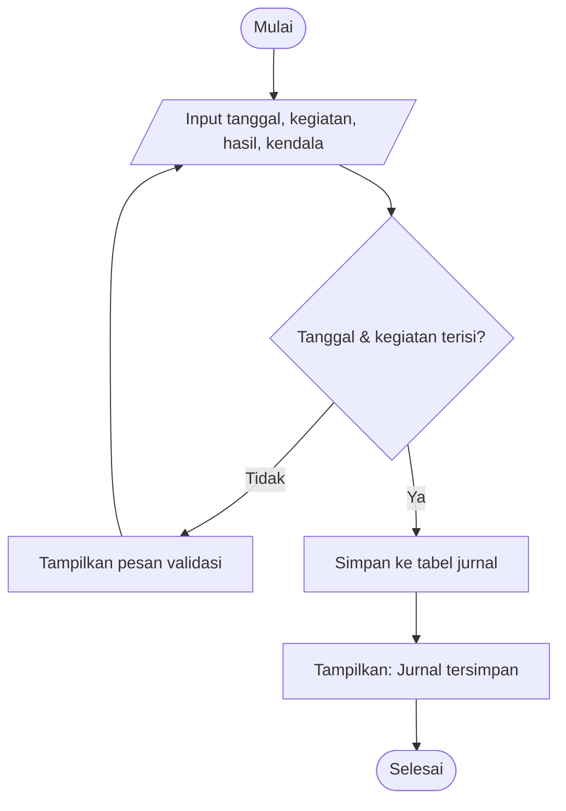
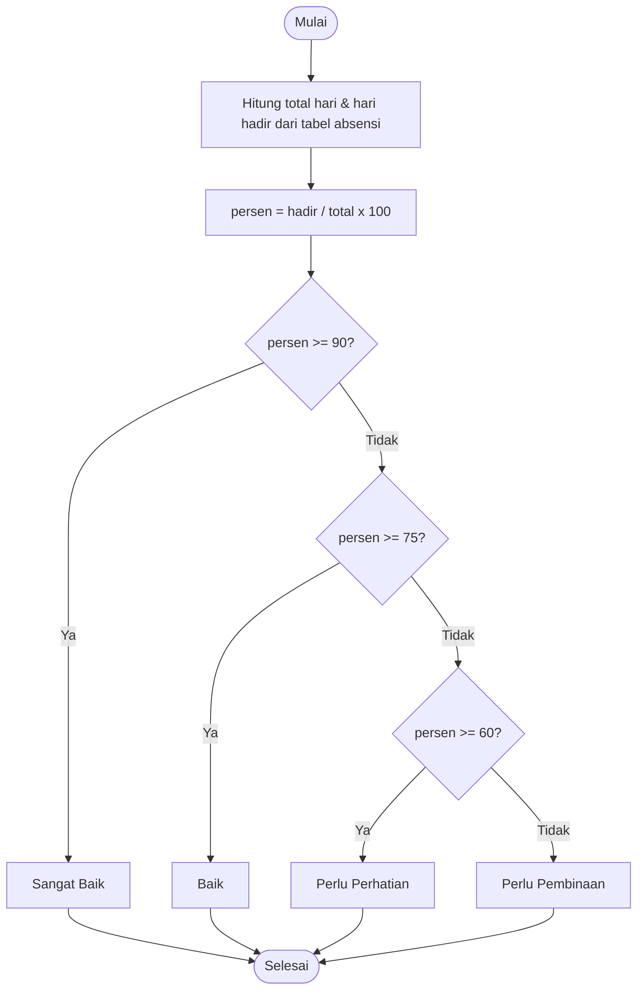
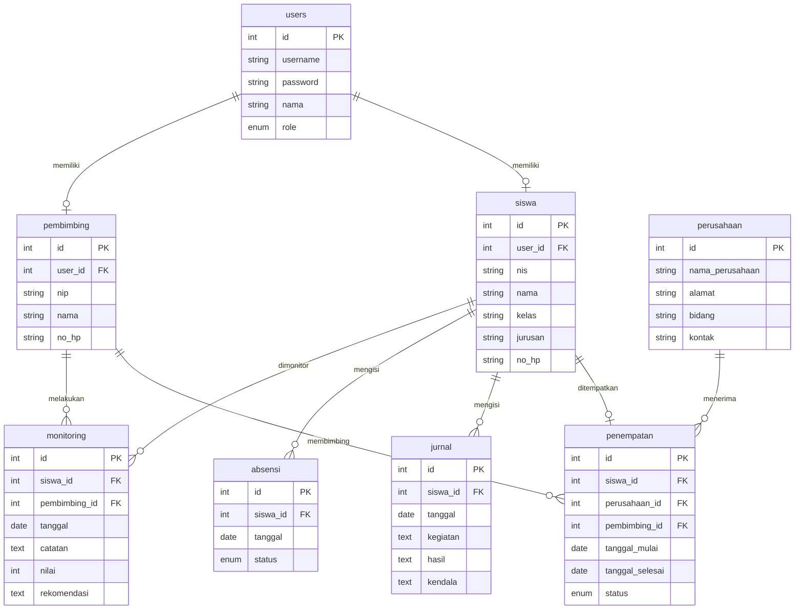

# DOKUMENTASI UKK – InternTrack
**Sistem Monitoring Kegiatan Praktik Kerja Lapangan (PKL) Siswa**
Skema: Junior Coder | Program Keahlian: Rekayasa Perangkat Lunak

> Catatan: bagian "Screenshot" harus diisi sendiri setelah aplikasi dijalankan (lihat bagian 3).

---

## 1. ANALISIS

### a. Identifikasi Masalah
1. Data siswa PKL, perusahaan, dan pembimbing masih dicatat manual (buku/Excel) sehingga mudah hilang dan tidak konsisten.
2. Guru pembimbing sulit memantau aktivitas harian siswa karena jurnal ditulis di kertas.
3. Rekap kehadiran siswa dihitung manual sehingga lambat dan rawan salah hitung.
4. Hasil monitoring dan penilaian pembimbing tidak tersimpan terpusat, sehingga sulit dicari dan dilaporkan.
5. Pembuatan laporan PKL (data siswa, kehadiran, monitoring) memakan waktu lama.

### b. Identifikasi Pengguna (Aktor)
| Aktor | Hak akses |
|---|---|
| Admin/Pembimbing | Login, dashboard, kelola siswa, perusahaan, pembimbing, penempatan, lihat jurnal & kehadiran, monitoring, ubah status PKL, laporan |
| Siswa | Login, lihat profil, lihat tempat PKL, isi jurnal, isi kehadiran, lihat status PKL, lihat hasil monitoring |

### c. Kebutuhan Fungsional
1. Sistem dapat melakukan login berdasarkan username dan password.
2. Sistem dapat membedakan hak akses Admin/Pembimbing dan Siswa.
3. Sistem dapat menampilkan dashboard berisi statistik dari database.
4. Sistem dapat mengelola (tambah, lihat, edit, hapus, cari, detail) data siswa.
5. Sistem dapat mengelola data perusahaan/instansi tempat PKL.
6. Sistem dapat mengelola data guru pembimbing.
7. Sistem dapat mengelola penempatan siswa ke perusahaan dan pembimbing beserta status (Belum Mulai/Aktif/Selesai).
8. Sistem dapat mencatat jurnal kegiatan harian siswa.
9. Sistem dapat mencatat kehadiran siswa (Hadir/Izin/Sakit/Alpa).
10. Sistem dapat menghitung persentase kehadiran dan menentukan status PKL otomatis.
11. Sistem dapat mencatat hasil monitoring pembimbing (catatan, nilai, rekomendasi).
12. Sistem dapat melakukan pencarian dan filter data (kelas, perusahaan, status PKL, pembimbing).
13. Sistem dapat menampilkan dan mencetak laporan data siswa, kehadiran, dan monitoring.

### d. Kebutuhan Non-Fungsional
1. Aplikasi dapat dijalankan melalui browser.
2. Data tersimpan dalam database relasional (MySQL/MariaDB).
3. Sistem memiliki validasi input.
4. Password disimpan dalam bentuk hash (`password_hash`).
5. Tampilan sederhana dan mudah digunakan (responsif).

---

## 2. PERANCANGAN

### Flowchart

**Algoritma 1 – Login**


**Algoritma 2 – Input Jurnal**


**Algoritma 3 – Penentuan Status PKL**


### Pseudocode

**Login**
```
INPUT username, password
IF username kosong ATAU password kosong THEN
    TAMPILKAN "Username dan password wajib diisi"
ELSE
    user = SELECT * FROM users WHERE username = username
    IF user ada DAN password_verify(password, user.password) THEN
        SIMPAN session(user)
        IF user.role = 'siswa' THEN redirect dashboard siswa
        ELSE redirect dashboard admin
    ELSE
        TAMPILKAN "Username atau password salah"
```

**Input Jurnal**
```
INPUT tanggal, kegiatan, hasil, kendala
IF tanggal kosong THEN TAMPILKAN "Tanggal wajib diisi"
IF kegiatan kosong THEN TAMPILKAN "Kegiatan wajib diisi"
IF tidak ada error THEN
    INSERT INTO jurnal (siswa_id, tanggal, kegiatan, hasil, kendala)
    TAMPILKAN "Jurnal tersimpan"
```

**Status PKL**
```
total = COUNT(absensi siswa)
hadir = COUNT(absensi siswa WHERE status = 'Hadir')
persen = hadir / total * 100
IF persen >= 90 THEN status = "Sangat Baik"
ELSE IF persen >= 75 THEN status = "Baik"
ELSE IF persen >= 60 THEN status = "Perlu Perhatian"
ELSE status = "Perlu Pembinaan"
```
Implementasi: fungsi `status_kehadiran()` dan `hitung_kehadiran()` di `config/koneksi.php`.

### ERD


### Struktur Database (database `interntrack`)
| Tabel | Primary Key | Foreign Key |
|---|---|---|
| users | id | - |
| siswa | id | user_id → users.id |
| perusahaan | id | - |
| pembimbing | id | user_id → users.id |
| penempatan | id | siswa_id → siswa.id; perusahaan_id → perusahaan.id; pembimbing_id → pembimbing.id |
| jurnal | id | siswa_id → siswa.id |
| absensi | id (+ unique siswa_id, tanggal) | siswa_id → siswa.id |
| monitoring | id | siswa_id → siswa.id; pembimbing_id → pembimbing.id |

Data dummy: 25 siswa, 10 perusahaan, 10 pembimbing, 10 penempatan, 30 jurnal, 30 absensi, 10 monitoring.

### Struktur Aplikasi
```
InternTrack/
├── config/      koneksi.php (koneksi DB + fungsi bantu), header.php, footer.php
├── assets/      style.css
├── auth/        login.php, logout.php
├── admin/       dashboard, siswa, perusahaan, pembimbing, penempatan, jurnal, absensi, monitoring
├── siswa/       dashboard, profil, tempat, jurnal, absensi, status, monitoring
├── laporan/     index, siswa, kehadiran, monitoring
├── database/    interntrack.sql
├── docs/        DOKUMENTASI.md
└── index.php
```

---

## 3. IMPLEMENTASI

### Screenshot (isi sendiri)
Ambil screenshot halaman berikut lalu tempel di dokumen akhir: Login, Dashboard Admin, Data Siswa (list, tambah, detail), Data Perusahaan, Penempatan, Jurnal, Absensi + rekap, Monitoring, Laporan, Dashboard Siswa.

### Penjelasan Fitur
| Fitur | Penjelasan |
|---|---|
| Login | Validasi username/password, hash `password_verify`, pesan "Username atau password salah." jika gagal |
| Dashboard | Angka (siswa, perusahaan, pembimbing, PKL aktif/selesai, jurnal hari ini, siswa perlu perhatian) dihitung dari query database |
| Data Siswa | Tambah, lihat, edit, hapus, cari (nama/NIS), detail, filter kelas/perusahaan/status/pembimbing; NIS wajib & tidak boleh duplikat |
| Data Perusahaan | Tambah, edit, hapus, detail, cari |
| Pembimbing | Tambah, edit, hapus, cari |
| Penempatan | Pilih siswa → perusahaan → pembimbing, tanggal mulai/selesai, status; status bisa diubah langsung dari tabel |
| Jurnal | Siswa mengisi tanggal, kegiatan, hasil, kendala; admin melihat semua jurnal |
| Absensi | Hadir/Izin/Sakit/Alpa; rekap otomatis persentase + status PKL |
| Monitoring | Pembimbing mengisi catatan, nilai (0–100), rekomendasi |
| Laporan | Data siswa PKL, kehadiran, monitoring; tombol Cetak |

---

## 4. TESTING

### Test Case
| No | Fitur | Skenario | Expected Result | Hasil |
|---|---|---|---|---|
| 1 | Login | Username & password benar | Berhasil login | ☐ |
| 2 | Login | Password salah | Login ditolak, muncul "Username atau password salah." | ☐ |
| 3 | Login | Username/password kosong | Muncul pesan validasi | ☐ |
| 4 | Siswa | Tambah data lengkap | Data tersimpan | ☐ |
| 5 | Siswa | NIS kosong | Muncul validasi | ☐ |
| 6 | Siswa | NIS duplikat | Data ditolak | ☐ |
| 7 | Jurnal | Input jurnal (tanggal & kegiatan terisi) | Data tersimpan | ☐ |
| 8 | Jurnal | Kegiatan kosong | Muncul validasi | ☐ |
| 9 | Absensi | Input hadir | Data tersimpan | ☐ |
| 10 | Absensi | Rekap kehadiran | Persentase & status muncul | ☐ |
| 11 | Monitoring | Input nilai | Data tersimpan | ☐ |
| 12 | Search | Cari nama siswa | Data sesuai tampil | ☐ |
| 13 | Dashboard | Buka dashboard | Angka sesuai isi database | ☐ |

### Hasil Pengujian
Centang kolom "Hasil" (✔ Berhasil / ✘ Gagal) setelah masing-masing skenario dijalankan.

---

## 5. MANUAL PENGGUNAAN
1. **Login** – buka `http://localhost/InternTrack/`, isi username & password, klik Login.
2. **Dashboard** – ringkasan angka PKL tampil otomatis setelah login.
3. **Data Siswa** – menu *Siswa* → *+ Tambah Siswa* → isi NIS, nama, kelas, jurusan, no. HP → Simpan. Gunakan kolom cari/filter untuk mencari.
4. **Penempatan** – menu *Penempatan* → *+ Tambah Penempatan* → pilih siswa, perusahaan, pembimbing, tanggal, status → Simpan.
5. **Jurnal** – login sebagai siswa → menu *Jurnal* → isi tanggal, kegiatan, hasil, kendala → Simpan Jurnal.
6. **Absensi** – siswa: menu *Absensi* → pilih status → Simpan. Admin: menu *Absensi* untuk input & lihat rekap persentase.
7. **Monitoring** – menu *Monitoring* → pilih siswa, isi catatan, nilai, rekomendasi → Simpan.
8. **Laporan** – menu *Laporan* → pilih jenis laporan → klik *Cetak* bila perlu.
